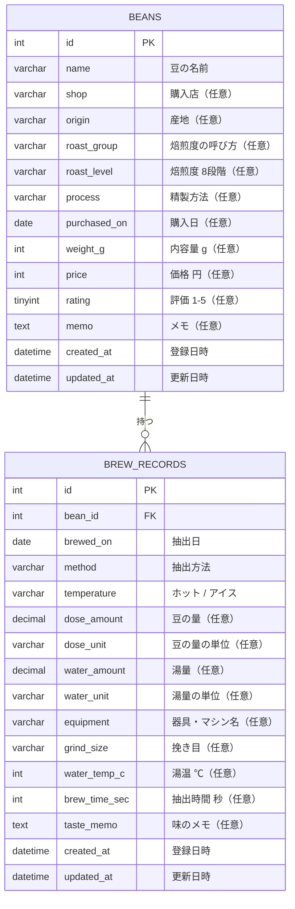

# データ設計書：coffee-bean-log

> 中央ドキュメント：[要件定義書.md](要件定義書.md)

## 1. データ項目（概要）

- **豆**：名前、購入店、産地、焙煎度（呼び方・8段階）、精製方法、購入日、内容量、価格、評価、メモ
- **抽出記録**：所属する豆、抽出日、抽出方法、ホット / アイス、豆の量（数値・単位）、湯量（数値・単位）、器具・マシン名、挽き目、湯温、抽出時間、味のメモ

## 2. ER図

| 関係 | 意味 |
|------|------|
| BEANS → BREW_RECORDS（1対多） | 1つの豆に複数の抽出記録。豆を削除すると、その豆の抽出記録も削除する |

## 3. テーブル定義

- 文字コードは `utf8mb4`（日本語・絵文字を扱えるようにする）。
- ID は `INT AUTO_INCREMENT` で採番する。
- 選択肢の項目は、英語のコード値で保存し、画面で日本語に変換して表示する（値は [4. 選択肢の保存値](#4-選択肢の保存値)）。
- 文字数・数値の範囲は、[機能要件.md](機能要件.md) の入力チェックに合わせる。
- テーブル作成の方法（マイグレーションツール）は、DB を準備する段階で決めて追記する。

### beans（豆）

| カラム | 型 | 制約 | 説明 |
|------|------|------|------|
| id | INT | PK, AUTO_INCREMENT | |
| name | VARCHAR(100) | NOT NULL | 豆の名前 |
| shop | VARCHAR(100) | | 購入店 |
| origin | VARCHAR(100) | | 産地（自由入力） |
| roast_group | VARCHAR(20) | CHECK（4区分のコード値） | 焙煎度の呼び方 |
| roast_level | VARCHAR(20) | CHECK（8段階のコード値） | 焙煎度（8段階）。呼び方だけで登録したときは NULL |
| process | VARCHAR(20) | CHECK（精製方法のコード値） | 精製方法 |
| purchased_on | DATE | | 購入日 |
| weight_g | INT | CHECK (1〜10000) | 内容量（g） |
| price | INT | CHECK (0〜1000000) | 価格（円） |
| rating | TINYINT | CHECK (1〜5) | 評価。未評価は NULL |
| memo | TEXT | | メモ（1000文字以内はアプリでチェック） |
| created_at | DATETIME | NOT NULL, DEFAULT CURRENT_TIMESTAMP | 登録日時。「新しい順」の並び替えに使う |
| updated_at | DATETIME | NOT NULL, DEFAULT CURRENT_TIMESTAMP ON UPDATE CURRENT_TIMESTAMP | 更新日時 |

**焙煎度の持ち方**

- 8段階を選んだときは、`roast_level` と、対応する `roast_group` の両方に値を入れる（例: `city` と `medium_dark`）。
- 呼び方だけを選んだときは、`roast_group` だけに値を入れ、`roast_level` は NULL にする。
- 焙煎度を選ばなかったときは、両方 NULL にする。
- `roast_level` と `roast_group` の組み合わせが正しいか（例: `city` なのに `light` になっていないか）は、アプリ（バックエンド）でチェックする。

### brew_records（抽出記録）

| カラム | 型 | 制約 | 説明 |
|------|------|------|------|
| id | INT | PK, AUTO_INCREMENT | |
| bean_id | INT | NOT NULL, FK → beans(id) ON DELETE CASCADE | 所属する豆 |
| brewed_on | DATE | NOT NULL | 抽出日 |
| method | VARCHAR(20) | NOT NULL, CHECK（抽出方法のコード値） | 抽出方法 |
| temperature | VARCHAR(10) | NOT NULL, DEFAULT 'hot', CHECK (`hot`, `ice`) | ホット / アイス |
| dose_amount | DECIMAL(5,1) | | 豆の量 |
| dose_unit | VARCHAR(10) | CHECK (`g`, `cup`) | 豆の量の単位 |
| water_amount | DECIMAL(5,1) | | 湯量 |
| water_unit | VARCHAR(10) | CHECK (`ml`, `cup`) | 湯量の単位 |
| equipment | VARCHAR(100) | | 器具・マシン名 |
| grind_size | VARCHAR(20) | CHECK（挽き目のコード値） | 挽き目 |
| water_temp_c | INT | CHECK (50〜100) | 湯温（℃） |
| brew_time_sec | INT | CHECK (1〜3600) | 抽出時間（秒） |
| taste_memo | TEXT | | 味のメモ（1000文字以内はアプリでチェック） |
| created_at | DATETIME | NOT NULL, DEFAULT CURRENT_TIMESTAMP | 登録日時 |
| updated_at | DATETIME | NOT NULL, DEFAULT CURRENT_TIMESTAMP ON UPDATE CURRENT_TIMESTAMP | 更新日時 |

**量と単位の持ち方**

- 量と単位は、両方入れるか、両方 NULL にする（量だけ・単位だけは不可）。アプリでチェックする。
- 量の範囲は単位によって変わるため（例: 豆の量は g なら 0.1〜1000、杯なら 0.5〜20）、アプリでチェックする。

### インデックス

| テーブル | カラム | 目的 |
|------|------|------|
| brew_records | bean_id | 豆ごとの抽出記録の取得（外部キーのため MySQL が自動で作成する） |

> 想定データ量は個人利用の範囲（豆は数百件程度）のため、絞り込み・並び替え用のインデックスは作らない。

## 4. 選択肢の保存値

**焙煎度の呼び方（`beans.roast_group`）**

| 保存値 | 表示 |
|------|------|
| light | 浅煎り |
| medium | 中煎り |
| medium_dark | 中深煎り |
| dark | 深煎り |

**焙煎度（`beans.roast_level`）**

| 保存値 | 表示 | 呼び方（`roast_group`） |
|------|------|------|
| light | ライト | light |
| cinnamon | シナモン | light |
| medium | ミディアム | medium |
| high | ハイ | medium |
| city | シティ | medium_dark |
| full_city | フルシティ | medium_dark |
| french | フレンチ | dark |
| italian | イタリアン | dark |

**精製方法（`beans.process`）**

| 保存値 | 表示 |
|------|------|
| washed | ウォッシュト |
| natural | ナチュラル |
| honey | ハニー |
| other | その他 |

**抽出方法（`brew_records.method`）**

| 保存値 | 表示 |
|------|------|
| hand_drip | ハンドドリップ |
| machine | コーヒーマシン |
| french_press | フレンチプレス |
| espresso | エスプレッソ |
| other | その他 |

**ホット / アイス（`brew_records.temperature`）**

| 保存値 | 表示 |
|------|------|
| hot | ホット |
| ice | アイス |

**挽き目（`brew_records.grind_size`）**

| 保存値 | 表示 |
|------|------|
| extra_fine | 極細 |
| fine | 細 |
| medium_fine | 中細 |
| medium | 中 |
| coarse | 粗 |

**単位（`brew_records.dose_unit` / `water_unit`）**

| 保存値 | 表示 |
|------|------|
| g | g |
| ml | ml |
| cup | 杯 |
