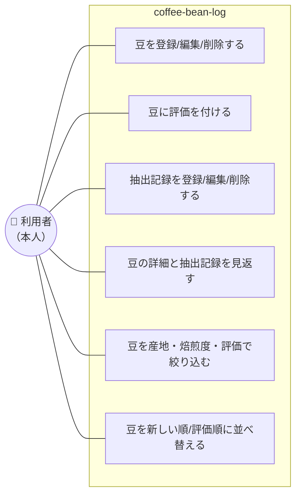

# 機能要件：coffee-bean-log

> 中央ドキュメント：[要件定義書.md](要件定義書.md)

ユーザーがアプリで行える操作（ユースケース）と、実装すべき機能の一覧を定義する。

## 1. ユースケース図

利用者（本人）がアプリで行える操作の一覧（今回のスコープのみ）。

## 2. 機能要件

状態の意味：**実装済み** ／ **未実装**（今回のスコープで、これから実装する） ／ **将来拡張**（今回は作らない）

| ID | 分類 | 機能 | 概要 | 状態 |
|----|------|------|------|------|
| F-01 | 豆 | 一覧表示 | 登録した豆を一覧で表示する。初期表示は新しい順 | 未実装 |
| F-02 | 豆 | 登録 | 豆の情報を入力して登録する（入力項目は [3.1](#31-豆の入力項目)） | 未実装 |
| F-03 | 豆 | 詳細表示 | 豆の情報と、その豆の抽出記録を表示する | 未実装 |
| F-04 | 豆 | 編集 | 豆の情報を変更する。評価は飲んでからあとで付けられる | 未実装 |
| F-05 | 豆 | 削除 | 確認のうえ豆を削除する。その豆の抽出記録も一緒に削除する | 未実装 |
| F-06 | 抽出記録 | 一覧表示 | 豆詳細画面で、その豆の抽出記録を新しい順に表示する | 未実装 |
| F-07 | 抽出記録 | 登録 | 豆に紐づけて抽出記録を登録する（入力項目は [3.2](#32-抽出記録の入力項目)） | 未実装 |
| F-08 | 抽出記録 | 編集 | 抽出記録を変更する | 未実装 |
| F-09 | 抽出記録 | 削除 | 確認のうえ抽出記録を削除する | 未実装 |
| F-10 | 絞り込み | 産地 | 豆一覧を産地のキーワード（部分一致）で絞り込む | 未実装 |
| F-11 | 絞り込み | 焙煎度 | 豆一覧を焙煎度（呼び方または8段階、複数選択可）で絞り込む | 未実装 |
| F-12 | 絞り込み | 評価 | 豆一覧を「★○ 以上」で絞り込む | 未実装 |
| F-13 | 並び替え | 豆一覧 | 豆一覧を新しい順 / 評価順で並べ替える | 未実装 |
| F-14 | ログイン | ログイン | ユーザー登録・ログインし、ユーザーごとにデータを分ける | 将来拡張 |
| F-15 | 写真 | アップロード | 豆のパッケージ写真を登録・表示する | 将来拡張 |
| F-16 | 集計 | 集計 | 産地別・焙煎度別の平均評価、抽出方法ごとの回数などをグラフで表示する | 将来拡張 |

> 各機能に対応する画面・操作は [画面設計書.md](画面設計書.md) を参照。

## 3. 機能の詳細

### 3.1 豆の入力項目

対応機能：F-02、F-04

| 項目 | 必須 | 形式・制約 | 例 |
|------|:----:|------|------|
| 豆の名前 | ○ | 文字列（100文字以内） | エチオピア イルガチェフェ |
| 購入店 | | 文字列（100文字以内） | 〇〇珈琲店 |
| 産地 | | 自由入力（100文字以内） | エチオピア イルガチェフェ |
| 焙煎度 | | 8段階、または大まかな呼び方（4区分）から選択（[焙煎度](#焙煎度)） | シティ（中深煎り） / 中煎り |
| 精製方法 | | 選択（ウォッシュト / ナチュラル / ハニー / その他）。分からなければ空欄でよい | ウォッシュト |
| 購入日 | | 日付 | 2026-11-18 |
| 内容量（g） | | 整数（1〜10000） | 200 |
| 価格（円） | | 整数（0〜1000000） | 1500 |
| 評価 | | 整数（1〜5）。飲んでから付けられるよう任意 | 4 |
| メモ | | 文字列（1000文字以内） | 店員さんのおすすめ |

#### 焙煎度

日本で広く使われている8段階の分類を使う。一般的な「浅煎り・中煎り」などとの対応が分かるよう、**画面では「シティ（中深煎り）」のように括弧書きで表示する**。

ただし、市販の豆は「中煎り」としか書いていなかったり、お店独自の表記（例: スターバックスの「ブロンド / ミディアム / ダーク」）だったりして、8段階のどれか分からないことが多い。そのため、**8段階が分からないときは、大まかな呼び方（浅煎り / 中煎り / 中深煎り / 深煎り）だけでも選べる**ようにする。

- 選択肢は、呼び方ごとに見出しを付けて並べる（例: 「中煎り」の下に「中煎り（細かい段階は不明）」「ミディアム」「ハイ」）。
- 8段階を選んだときは、対応する呼び方も自動で記録する。

| 焙煎度 | 一般的な呼び方 | 味の傾向 |
|------|------|------|
| ライト | 浅煎り | 酸味が強い |
| シナモン | 浅煎り | 酸味が強い |
| ミディアム | 中煎り | 酸味と苦味のバランス |
| ハイ | 中煎り | 酸味と苦味のバランス |
| シティ | 中深煎り | 苦味が出てくる |
| フルシティ | 中深煎り | 苦味が出てくる |
| フレンチ | 深煎り | 苦味が強い |
| イタリアン | 深煎り | 苦味が強い |

### 3.2 抽出記録の入力項目

対応機能：F-07、F-08

**コーヒーマシンの人も使いやすくする工夫**

- 入力項目を「**基本**」と「**詳細（任意）**」に分け、詳細は折りたたんでおく。マシンの人は基本だけ入力すれば記録できる。
- 豆の量・湯量は、グラム・ml だけでなく **杯（スプーン）** でも記録できる。
- 抽出方法で「コーヒーマシン」を選んだときは、マシンでは設定できないことが多い項目（湯温・抽出時間）を詳細に入れたままにし、目立たせない。

**基本**

| 項目 | 必須 | 形式・制約 | 例 |
|------|:----:|------|------|
| 抽出日 | ○ | 日付（初期値は今日） | 2026-11-20 |
| 抽出方法 | ○ | 選択（[抽出方法の選択肢](#抽出方法の選択肢)） | コーヒーマシン |
| ホット / アイス | ○ | 選択（ホット / アイス）。初期値はホット | アイス |
| 豆の量 | | 数値 ＋ 単位（g / 杯）。g は 0.1〜1000、杯は 0.5〜20 | 15 g / 2 杯 |
| 湯量 | | 数値 ＋ 単位（ml / 杯）。ml は 1〜5000、杯は 1〜20 | 240 ml / 2 杯 |
| 味のメモ | | 文字列（1000文字以内） | 酸味が明るく、後味がすっきり |

**詳細（任意）**

| 項目 | 必須 | 形式・制約 | 例 |
|------|:----:|------|------|
| 器具・マシン名 | | 文字列（100文字以内） | ハリオ V60 / 〇〇社 全自動マシン |
| 挽き目 | | 選択（極細 / 細 / 中細 / 中 / 粗） | 中細 |
| 湯温（℃） | | 整数（50〜100） | 90 |
| 抽出時間（秒） | | 整数（1〜3600） | 180 |

#### 抽出方法の選択肢

| 抽出方法 | 説明 |
|------|------|
| ハンドドリップ | ペーパー・ネルなどで手で淹れる |
| コーヒーマシン | 自宅のコーヒーメーカー・全自動マシン・カプセル式など |
| フレンチプレス | |
| エスプレッソ | エスプレッソマシンで淹れる |
| その他 | 水出し・エアロプレスなど |

### 3.3 絞り込みのルール

対応機能：F-10、F-11、F-12

豆一覧を、次の条件で絞り込める。条件は組み合わせられる（AND 条件）。

| 条件 | 指定方法 |
|------|------|
| 産地 | キーワード入力（部分一致）。例: 「エチオピア」で「エチオピア イルガチェフェ」も対象 |
| 焙煎度 | 呼び方（浅煎り / 中煎り / 中深煎り / 深煎り）または8段階から選択（複数選択可） |
| 評価 | 「★○ 以上」を選択（1〜5） |

- 焙煎度を**呼び方で選んだとき**は、その呼び方の豆をすべて表示する（8段階で登録した豆も、呼び方だけで登録した豆も含む）。例: 「中煎り」→ ミディアム・ハイ・「中煎り（細かい段階は不明）」の豆。
- 焙煎度を**8段階で選んだとき**は、その段階で登録した豆だけを表示する。
- 評価は**豆に付けた評価**で判定する。評価が未入力の豆は、評価で絞り込んだときは表示しない。
- 絞り込み条件をクリアするボタンを用意する。

### 3.4 並び替えのルール

対応機能：F-13

豆一覧の並び順を切り替えられる。絞り込みと組み合わせて使える。

| 並び順 | 内容 |
|------|------|
| 新しい順（初期表示） | 登録日の新しい順 |
| 評価順 | 評価の高い順。同じ評価の豆は新しい順。評価が未入力の豆は最後に表示する |
