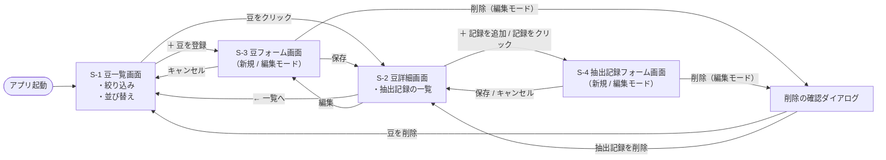

# 画面設計書：coffee-bean-log

> 中央ドキュメント：[要件定義書.md](要件定義書.md) ／ 対応する機能一覧：[機能要件.md](機能要件.md)

## 1. 画面一覧

| No | 画面名 | 種別 | 役割 |
|----|--------|------|------|
| S-1 | 豆一覧画面 | ページ | アプリの入口。豆の一覧を表示。絞り込み・並び替え・新規登録 |
| S-2 | 豆詳細画面 | ページ | 豆の情報と、その豆の抽出記録の一覧を表示 |
| S-3 | 豆フォーム画面 | ページ | 豆の登録（新規モード）と編集（編集モード）。編集モードでは豆の削除もできる |
| S-4 | 抽出記録フォーム画面 | ページ | 抽出記録の登録（新規モード）と編集（編集モード）。編集モードでは抽出記録の削除もできる |

> 画面のレイアウトは、次のステップの画面モックで実際に触って確かめ、必要に応じて見直す。

## 2. 画面遷移図



- S-3 の「キャンセル」は、新規モードでは S-1、編集モードでは S-2 に戻る。
- 削除の確認ダイアログで「キャンセル」を押したときは、元のフォーム画面に戻る。

## 3. ワイヤーフレーム

### S-1 豆一覧画面

```
┌──────────────────────────────────────────────┐
│  ☕ coffee-bean-log              [＋ 豆を登録] │ ← ヘッダー／新規登録
├──────────────────────────────────────────────┤
│  産地 [ エチオピア        ]                    │
│  焙煎度 [ 中煎り, シティ ▼ ]  評価 [ ★3以上 ▼ ] │ ← 絞り込み
│                                  [クリア]     │
│  並び順 (●)新しい順 ( )評価順      12件        │ ← 並び替え／件数
├──────────────────────────────────────────────┤
│  ┌──────────────────────────────────────┐    │
│  │ エチオピア イルガチェフェ      ★★★★☆ │    │
│  │ エチオピア ／ シティ（中深煎り）       │    │
│  └──────────────────────────────────────┘    │
│  ┌──────────────────────────────────────┐    │
│  │ パイクプレイス ロースト        未評価  │    │
│  │ ラテンアメリカ ／ 中深煎り             │    │
│  └──────────────────────────────────────┘    │
│                                              │
│  （豆がないとき：「まだ豆が登録されていません」）  │
└──────────────────────────────────────────────┘
```

| 要素 | 操作 | 動き | 対応機能 |
|------|------|------|----------|
| [＋ 豆を登録] | クリック | **S-3**（新規モード）を開く | F-02 |
| 産地 | 入力 | 産地の部分一致で絞り込む | F-10 |
| 焙煎度 | 選択 | 呼び方または8段階で絞り込む（複数選択可） | F-11 |
| 評価 | 選択 | 「★○ 以上」で絞り込む | F-12 |
| [クリア] | クリック | 絞り込み条件をすべて解除する | F-10〜12 |
| 並び順 | 選択 | 新しい順 / 評価順を切り替える | F-13 |
| 件数 | 表示 | 絞り込み後の件数 | － |
| 豆のカード | クリック | **S-2** を開く | F-03 |
| 豆のカード上の表示 | 表示 | 名前 / 評価（未入力は「未評価」）/ 産地 / 焙煎度 | F-01 |

**表示のルール**

- 焙煎度は「シティ（中深煎り）」のように呼び方を括弧で添える。呼び方だけで登録した豆は「中深煎り」と表示する。
- 絞り込みの結果が0件のときは「条件に合う豆がありません」と表示する。

### S-2 豆詳細画面

```
┌──────────────────────────────────────────────┐
│  ← 一覧へ                          [ 編集 ]   │
├──────────────────────────────────────────────┤
│  エチオピア イルガチェフェ           ★★★★☆   │
│                                              │
│  購入店    〇〇珈琲店                          │
│  産地      エチオピア イルガチェフェ             │
│  焙煎度    シティ（中深煎り）                   │
│  精製方法  ウォッシュト                         │
│  購入日    2026-11-18                         │
│  内容量    200 g      価格  1,500 円           │
│  メモ      店員さんのおすすめ                   │
├──────────────────────────────────────────────┤
│  抽出記録（3件）                [＋ 記録を追加] │
│  ┌──────────────────────────────────────┐    │
│  │ 2026-11-20  ハンドドリップ             │    │
│  │ 15 g ／ 240 ml                        │    │
│  │ 酸味が明るく、後味がすっきり           │    │
│  └──────────────────────────────────────┘    │
│  ┌──────────────────────────────────────┐    │
│  │ 2026-11-19  コーヒーマシン             │    │
│  │ 2 杯 ／ 2 杯                          │    │
│  └──────────────────────────────────────┘    │
│  （記録がないとき：「まだ記録がありません」）     │
└──────────────────────────────────────────────┘
```

| 要素 | 操作 | 動き | 対応機能 |
|------|------|------|----------|
| ← 一覧へ | クリック | **S-1** に戻る（絞り込み・並び順は保ったまま） | － |
| [ 編集 ] | クリック | **S-3**（編集モード）を開く | F-04 |
| 豆の情報 | 表示 | 入力した項目を表示する。未入力の項目は表示しない | F-03 |
| [＋ 記録を追加] | クリック | **S-4**（新規モード）を開く | F-07 |
| 抽出記録のカード | クリック | **S-4**（編集モード）を開く | F-08 |
| 抽出記録のカード上の表示 | 表示 | 抽出日 / 抽出方法 / 豆の量・湯量 / 味のメモ（新しい順） | F-06 |

### S-3 豆フォーム画面

```
┌──────────────────────────────────────────────┐
│  豆を登録（編集モードは「豆を編集」）            │
├──────────────────────────────────────────────┤
│  豆の名前 *                                    │
│  [ エチオピア イルガチェフェ                 ]  │
│  購入店                                        │
│  [ 〇〇珈琲店                                ]  │
│  産地                                          │
│  [ エチオピア イルガチェフェ                 ]  │
│  焙煎度                                        │
│  [ シティ（中深煎り）                      ▼ ]  │ ← 呼び方ごとの見出し付き
│  精製方法                                      │
│  [ ウォッシュト                            ▼ ]  │
│  購入日                                        │
│  [ 2026-11-18 ]                               │
│  内容量（g）          価格（円）                │
│  [ 200       ]       [ 1500      ]            │
│  評価                                          │
│  ☆ ☆ ☆ ☆ ☆   （飲んでからでも付けられます）     │
│  メモ                                          │
│  [ 店員さんのおすすめ                        ]  │
│                                              │
│  [ 削除 ]                [キャンセル] [ 保存 ] │ ← ［削除］は編集モードのみ
└──────────────────────────────────────────────┘
```

| 要素 | 操作 | 動き | 対応機能 |
|------|------|------|----------|
| 各入力欄 | 入力 / 選択 | 入力項目と制約は [機能要件.md 3.1](機能要件.md#31-豆の入力項目) のとおり | F-02, 04 |
| 焙煎度 | 選択 | 見出し（浅煎り / 中煎り / 中深煎り / 深煎り）の下に「〇〇（細かい段階は不明）」と8段階を並べる | F-02, 04 |
| 評価 | クリック | ★1〜5 を付ける。もう一度押すと未評価に戻す | F-04 |
| [ 保存 ] | クリック | 入力チェックをして保存し、**S-2** を開く。エラーがあれば欄の下に表示する | F-02, 04 |
| [キャンセル] | クリック | 保存せずに戻る（新規モードは S-1、編集モードは S-2） | － |
| [ 削除 ] | クリック | 削除の確認ダイアログを開く（編集モードのみ） | F-05 |

### S-4 抽出記録フォーム画面

```
┌──────────────────────────────────────────────┐
│  記録を追加（編集モードは「記録を編集」）        │
│  エチオピア イルガチェフェ                      │ ← どの豆の記録か
├──────────────────────────────────────────────┤
│  抽出日 *                                      │
│  [ 2026-11-23 ]                               │
│  抽出方法 *                                    │
│  [ コーヒーマシン                          ▼ ]  │
│  豆の量                 湯量                   │
│  [ 2    ] [ 杯 ▼ ]     [ 2    ] [ 杯 ▼ ]      │ ← 単位は g / 杯、ml / 杯
│  味のメモ                                      │
│  [ 酸味が明るく、後味がすっきり             ]  │
│                                              │
│  ▶ 詳細（任意）                                │ ← 折りたたみ。開くと下が出る
│  ┊ 器具・マシン名  [ 〇〇社 全自動マシン    ]  │
│  ┊ 挽き目          [ 中細               ▼ ]  │
│  ┊ 湯温（℃）       [ 90  ]                    │
│  ┊ 抽出時間（秒）  [ 180 ]                    │
│                                              │
│  [ 削除 ]                [キャンセル] [ 保存 ] │ ← ［削除］は編集モードのみ
└──────────────────────────────────────────────┘
```

| 要素 | 操作 | 動き | 対応機能 |
|------|------|------|----------|
| 各入力欄 | 入力 / 選択 | 入力項目と制約は [機能要件.md 3.2](機能要件.md#32-抽出記録の入力項目) のとおり | F-07, 08 |
| 抽出日 | 日付選択 | 新規モードの初期値は今日 | F-07 |
| 豆の量・湯量の単位 | 選択 | g / 杯、ml / 杯 を切り替える | F-07, 08 |
| ▶ 詳細（任意） | クリック | 詳細の入力欄を開く / 閉じる。編集モードで詳細に値があるときは、最初から開いておく | F-07, 08 |
| [ 保存 ] | クリック | 入力チェックをして保存し、**S-2** に戻る | F-07, 08 |
| [キャンセル] | クリック | 保存せずに **S-2** に戻る | － |
| [ 削除 ] | クリック | 削除の確認ダイアログを開く（編集モードのみ） | F-09 |

### 削除の確認ダイアログ

```
      ┌──────────────────────────────────┐
      │  この豆を削除しますか？            │
      │  抽出記録（3件）も一緒に削除されます。│ ← 豆の削除のときだけ表示
      │                                  │
      │           [キャンセル] [ 削除 ]   │
      └──────────────────────────────────┘
```

| 要素 | 操作 | 動き | 対応機能 |
|------|------|------|----------|
| [ 削除 ] | クリック | 削除する。豆は **S-1**、抽出記録は **S-2** に戻る | F-05, 09 |
| [キャンセル] | クリック | 削除せずにフォーム画面に戻る | － |
