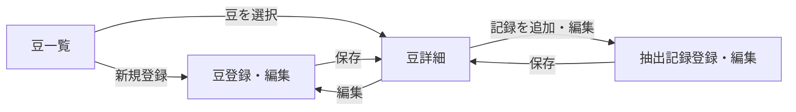
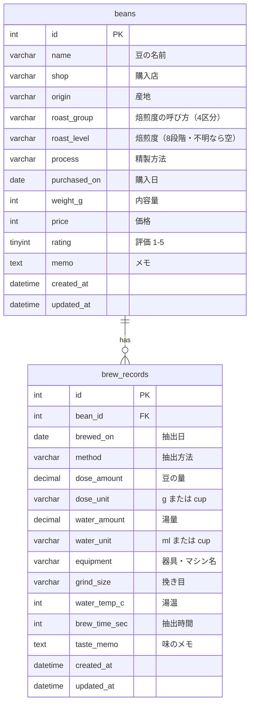

# 要件定義書

| 項目 | 内容 |
| --- | --- |
| プロジェクト名 | coffee-bean-log |
| 版 | 1.0 |
| 作成日 | 2026-11-22 |
| 更新日 | 2026-11-23 |
| 関連 Issue | #1 |

---

## 1. 概要

### 1.1 目的

買ったコーヒー豆と、その豆を淹れた記録（抽出記録）を残し、**自分の好みの豆や淹れ方を振り返れる**ようにする。

### 1.2 想定ユーザー

- 自分（個人利用）
- 自宅でコーヒーを淹れ、豆ごとの味の違いを記録したい人
  - ハンドドリップで細かく淹れ方を記録したい人
  - **自宅のコーヒーマシンで淹れる人**（細かい数値は記録せず、手軽に残したい人）

### 1.3 背景

- スクールの学習課題（**初級編の最終課題**）として開発する。
- これまでの課題（React / Java / Spring Boot / PostgreSQL）とは**異なる技術スタック**を使うことが条件。
- 一度に作り込まず、MVP から段階的に機能を追加する。

---

## 2. スコープ

| 機能 | MVP | あとから追加 |
| --- | :---: | :---: |
| 豆の管理 | ○ | |
| 抽出記録 | ○ | |
| 産地・焙煎度・評価での絞り込み | ○ | |
| 豆一覧の並び替え（新しい順 / 評価順） | ○ | |
| ログイン | | ○ |
| 写真アップロード | | ○ |
| 集計 | | ○ |

---

## 3. 機能要件（MVP）

### 3.1 豆の管理

買った豆を登録・閲覧・編集・削除できる。

| 操作 | 内容 |
| --- | --- |
| 一覧 | 登録した豆を一覧で表示する（初期表示は新しい順。並び替えは 3.4） |
| 登録 | 豆の情報を入力して登録する |
| 詳細 | 豆の情報と、その豆の抽出記録を表示する |
| 編集 | 豆の情報を変更する（評価はあとから付けられる） |
| 削除 | 豆を削除する（確認ダイアログを出す） |

**入力項目**

| 項目 | 必須 | 形式・制約 | 例 |
| --- | :---: | --- | --- |
| 豆の名前 | ○ | 文字列（100文字以内） | エチオピア イルガチェフェ |
| 購入店 | | 文字列（100文字以内） | 〇〇珈琲店 |
| 産地 | | 自由入力（100文字以内） | エチオピア イルガチェフェ |
| 焙煎度 | | 8段階、または大まかな呼び方（4区分）から選択（下記） | シティ（中深煎り） / 中煎り |
| 精製方法 | | 選択（ウォッシュト / ナチュラル / ハニー / その他）。分からなければ空欄でよい | ウォッシュト |
| 購入日 | | 日付 | 2026-11-18 |
| 内容量（g） | | 整数（1〜10000） | 200 |
| 価格（円） | | 整数（0〜1000000） | 1500 |
| 評価 | | 整数（1〜5）。飲んでから付けられるよう任意 | 4 |
| メモ | | 文字列（1000文字以内） | 店員さんのおすすめ |

**焙煎度**

日本で広く使われている8段階の分類を使う。一般的な「浅煎り・中煎り」などとの対応が分かるよう、**画面では「シティ（中深煎り）」のように括弧書きで表示する**。

ただし、市販の豆は「中煎り」としか書いていなかったり、お店独自の表記（例: スターバックスの「ブロンド / ミディアム / ダーク」）だったりして、8段階のどれか分からないことが多い。そのため、**8段階が分からないときは、大まかな呼び方（浅煎り / 中煎り / 中深煎り / 深煎り）だけでも選べる**ようにする。

- 選択肢は、呼び方ごとに見出しを付けて並べる（例: 「中煎り」の下に「中煎り（細かい段階は不明）」「ミディアム」「ハイ」）。
- 8段階を選んだときは、対応する呼び方も自動で記録する。

| 焙煎度 | 一般的な呼び方 | 味の傾向 |
| --- | --- | --- |
| ライト | 浅煎り | 酸味が強い |
| シナモン | 浅煎り | 酸味が強い |
| ミディアム | 中煎り | 酸味と苦味のバランス |
| ハイ | 中煎り | 酸味と苦味のバランス |
| シティ | 中深煎り | 苦味が出てくる |
| フルシティ | 中深煎り | 苦味が出てくる |
| フレンチ | 深煎り | 苦味が強い |
| イタリアン | 深煎り | 苦味が強い |

### 3.2 抽出記録

豆ごとに、淹れたときの記録を登録・閲覧・編集・削除できる。

| 操作 | 内容 |
| --- | --- |
| 一覧 | 豆詳細画面で、その豆の抽出記録を新しい順に表示する |
| 登録 | 豆を選んで抽出記録を登録する |
| 編集 | 抽出記録を変更する |
| 削除 | 抽出記録を削除する（確認ダイアログを出す） |

- 豆を削除したときは、その豆の抽出記録も一緒に削除する。

**コーヒーマシンの人も使いやすくする工夫**

- 入力項目を「**基本**」と「**詳細（任意）**」に分け、詳細は折りたたんでおく。マシンの人は基本だけ入力すれば記録できる。
- 豆の量・湯量は、グラム・ml だけでなく **杯（スプーン）** でも記録できる。
- 抽出方法で「コーヒーマシン」を選んだときは、マシンでは設定できないことが多い項目（湯温・抽出時間）を詳細に入れたままにし、目立たせない。

**入力項目（基本）**

| 項目 | 必須 | 形式・制約 | 例 |
| --- | :---: | --- | --- |
| 抽出日 | ○ | 日付（初期値は今日） | 2026-11-20 |
| 抽出方法 | ○ | 選択（下記） | コーヒーマシン |
| 豆の量 | | 数値 ＋ 単位（g / 杯）。g は 0.1〜1000、杯は 0.5〜20 | 15 g / 2 杯 |
| 湯量 | | 数値 ＋ 単位（ml / 杯）。ml は 1〜5000、杯は 1〜20 | 240 ml / 2 杯 |
| 味のメモ | | 文字列（1000文字以内） | 酸味が明るく、後味がすっきり |

**入力項目（詳細・任意）**

| 項目 | 必須 | 形式・制約 | 例 |
| --- | :---: | --- | --- |
| 器具・マシン名 | | 文字列（100文字以内） | ハリオ V60 / 〇〇社 全自動マシン |
| 挽き目 | | 選択（極細 / 細 / 中細 / 中 / 粗） | 中細 |
| 湯温（℃） | | 整数（50〜100） | 90 |
| 抽出時間（秒） | | 整数（1〜3600） | 180 |

**抽出方法の選択肢**

| 抽出方法 | 説明 |
| --- | --- |
| ハンドドリップ | ペーパー・ネルなどで手で淹れる |
| コーヒーマシン | 自宅のコーヒーメーカー・全自動マシン・カプセル式など |
| フレンチプレス | |
| エスプレッソ | エスプレッソマシンで淹れる |
| その他 | 水出し・エアロプレスなど |

### 3.3 絞り込み

豆一覧を、次の条件で絞り込める。条件は組み合わせられる（AND 条件）。

| 条件 | 指定方法 |
| --- | --- |
| 産地 | キーワード入力（部分一致）。例: 「エチオピア」で「エチオピア イルガチェフェ」も対象 |
| 焙煎度 | 呼び方（浅煎り / 中煎り / 中深煎り / 深煎り）または8段階から選択（複数選択可） |
| 評価 | 「★○ 以上」を選択（1〜5） |

- 焙煎度を**呼び方で選んだとき**は、その呼び方の豆をすべて表示する（8段階で登録した豆も、呼び方だけで登録した豆も含む）。例: 「中煎り」→ ミディアム・ハイ・「中煎り（細かい段階は不明）」の豆。
- 焙煎度を**8段階で選んだとき**は、その段階で登録した豆だけを表示する。
- 評価は**豆に付けた評価**で判定する。評価が未入力の豆は、評価で絞り込んだときは表示しない。
- 絞り込み条件をクリアするボタンを用意する。

### 3.4 並び替え

豆一覧の並び順を切り替えられる。絞り込みと組み合わせて使える。

| 並び順 | 内容 |
| --- | --- |
| 新しい順（初期表示） | 登録日の新しい順 |
| 評価順 | 評価の高い順。同じ評価の豆は新しい順。評価が未入力の豆は最後に表示する |

---

## 4. 非機能要件

| 区分 | 内容 |
| --- | --- |
| 対応環境 | PC・スマートフォンのブラウザ（最新版の Chrome / Safari / Edge）。レスポンシブ対応 |
| 入力チェック | 必須項目・文字数・数値の範囲を、フロントエンドとバックエンドの両方でチェックする |
| エラー表示 | 入力エラーや通信エラーは、画面上に日本語で表示する |
| 認証 | MVP では認証なし（ログインは将来追加） |
| 稼働 | 常時稼働はしない。動作確認・スクリーンショット撮影のときだけ起動する |
| インフラ管理 | AWS 環境は Terraform で作成し、確認が終わったら `terraform destroy` で削除する |

---

## 5. 画面一覧

| No. | 画面 | 主な内容 |
| --- | --- | --- |
| 1 | 豆一覧 | 豆の一覧（名前・産地・焙煎度・評価）、絞り込み、並び替え、新規登録ボタン |
| 2 | 豆登録・編集 | 豆の入力フォーム |
| 3 | 豆詳細 | 豆の情報、評価、抽出記録一覧、抽出記録の追加ボタン |
| 4 | 抽出記録登録・編集 | 抽出記録の入力フォーム（基本 ＋ 折りたたみの詳細） |

**画面遷移**

---

## 6. データ構成（概要）

豆（`beans`）と抽出記録（`brew_records`）は **1 対多**。

- 焙煎度は「呼び方（`roast_group`）」と「8段階（`roast_level`）」の2つで持つ。8段階を選んだときは両方に値が入り、呼び方だけを選んだときは `roast_level` を空にする。

※ テーブル名・カラム名は設計時に見直す。

---

## 7. 技術構成

| 区分 | 技術 |
| --- | --- |
| フロントエンド | Vue 3 + TypeScript |
| バックエンド | Python + FastAPI（パッケージ管理は uv） |
| データベース | MySQL（本番は RDS for MySQL） |
| 本番環境 | AWS（EC2 1台 + RDS for MySQL） |
| インフラ構築 | Terraform |

---

## 8. 将来追加する機能

| 機能 | 内容 | 想定される変更 |
| --- | --- | --- |
| ログイン | ユーザー登録・ログインし、ユーザーごとにデータを分ける | `users` テーブルを追加し、`beans` に `user_id` を持たせる |
| 写真アップロード | 豆のパッケージ写真を登録・表示する | 画像の保存先（S3 など）を追加し、`beans` に画像の参照を持たせる |
| 集計 | 産地別・焙煎度別の平均評価、抽出方法ごとの回数などをグラフで表示する | 集計用 API と集計画面を追加する |

---

## 9. 決定事項

| No. | 内容 | 決定 | 理由 |
| --- | --- | --- | --- |
| 1 | 評価をどこに付けるか | 豆に付ける | 「どの豆が好みか」を振り返るのが主な目的のため |
| 2 | 産地の入力方法 | 自由入力 | 国だけ・農園までなど、書き方を自由にしたいため。絞り込みは部分一致で対応する |
| 3 | 焙煎度の段階数 | 8段階。分からないときは大まかな呼び方（4区分）だけでも選べる | 8段階は一般的な分類のため。市販の豆は「中煎り」などの表記しかないことが多いため、呼び方だけの登録も認める |
| 4 | 焙煎日 | 記録しない | 購入日があれば十分なため |
| 5 | 豆の量・湯量の単位 | g・ml に加えて杯も選べる | コーヒーマシンの人はスプーンで量ることが多いため |
| 6 | 精製方法が分からない豆 | 空欄で登録できる | 市販の豆は袋に精製方法が書いていないことが多いため |
| 7 | 豆一覧の並び替え | 新しい順（初期表示）と評価順を切り替えられる | 「どの豆が好みか」をすぐ振り返れるようにするため |
